<div align="center">

# Footnote

**What IPOs bury in the fine print, with the page to prove it.**

An Indian IPO offer document (DRHP, RHP or prospectus) runs 300 to 800 pages. Who owns the
company, which family firms it trades with, who its bankers are, and which cases it is
fighting are all disclosed, scattered across sections almost nobody reads.

Footnote reads the whole filing, maps **who is connected to the company and where the money
goes**, runs fixed checks over what it finds, and links every line to the page of the PDF it
came from, with the quote highlighted.

<p>
  <a href="https://footnote-story.vercel.app"><b>Read the case study</b></a>
  &nbsp;·&nbsp;
  <a href="#quickstart">Run it locally</a>
  &nbsp;·&nbsp;
  <a href="docs/architecture.md">Architecture</a>
  &nbsp;·&nbsp;
  <a href="docs/red-flag-rules.md">The rules</a>
</p>

<p>
  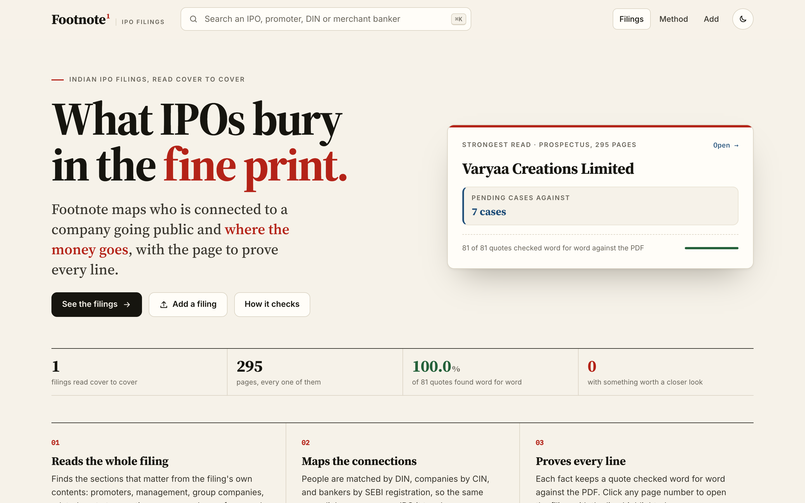
</p>

<p>
  <a href="LICENSE"></a>
  <a href="https://github.com/prutxvi/footnote/actions/workflows/ci.yml"></a>
  
  
  
  
  
  
</p>

</div>

---

## Contents

- [What you get for each filing](#what-you-get-for-each-filing)
- [Screenshots](#screenshots)
- [Results on real filings](#results-on-real-filings)
- [How it works](#how-it-works)
- [Quickstart](#quickstart)
- [Project structure](#project-structure)
- [API](#api)
- [Limits, and what this is not](#limits-and-what-this-is-not)
- [Roadmap](#roadmap)

## What you get for each filing

| | |
|---|---|
| **A one-line headline** | Written from the strongest finding, not a summary, or a plain statement that nothing tripped the checks. |
| **Red flags from fixed rules** | Related-party business as a share of revenue, money lent to related parties, IPO money going to related parties, auditor resignations, pending criminal or regulatory cases, the lead manager's record, and profit without operating cash. No model decides what is suspicious. |
| **A connection map** | Promoters and directors on the left, group and related companies on the right, bankers and auditors on top, the company in the centre. Money is drawn in red with thickness by amount. Deterministic layout, not a force blob. |
| **The source, always** | Click any flag, line, box or page number and the real PDF page opens with the quote highlighted. Every quote is checked word for word against its page; anything not found is marked **unverified** and never silently trusted. |
| **People and companies across IPOs** | People link only by **DIN**, companies by **CIN**, **SEBI registration** or name, so "everywhere this banker appears" is one click, and names that collide do not merge. |
| **Questions with citations** | Answers use only the filing and cite `S1 · p.73`-style sources. Retrieval is TF-IDF over the filing's own facts and pages: no embedding API, no vector database. |
| **An investigative-report UI** | Serif headlines, paper surfaces, red only where money or risk is involved. A ledger of totals, a sticky section nav, `⌘K` search, dark mode, and a layout that works on a phone. |

## Screenshots

All captured from the running app on the Varyaa Creations prospectus, a public BSE SME filing.

<table>
  <tr>
    <td width="50%" valign="top">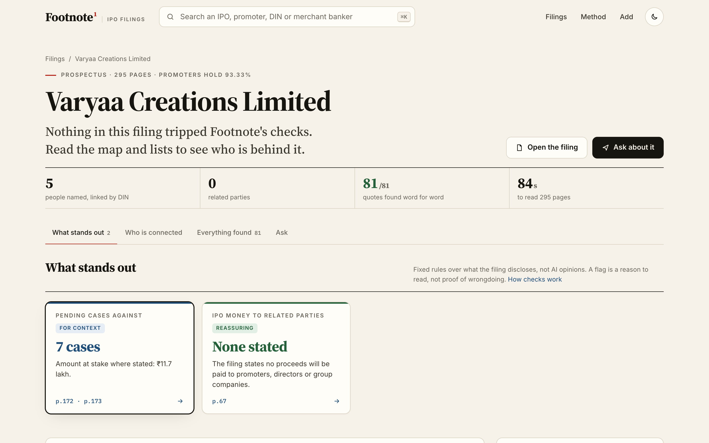<br><sub><b>Filing</b>: the headline, a ledger of what was read and verified, and a section nav that follows the scroll.</sub></td>
    <td width="50%" valign="top">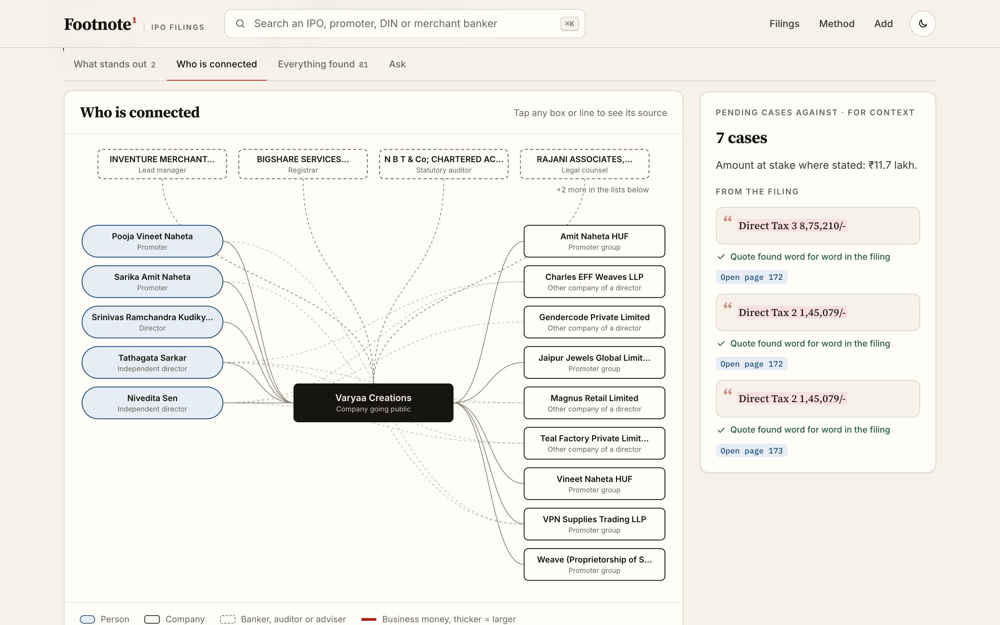<br><sub><b>Who is connected</b>: promoters, directors, group companies, bankers and auditors, with the selected flag's sources on the right.</sub></td>
  </tr>
  <tr>
    <td width="50%" valign="top">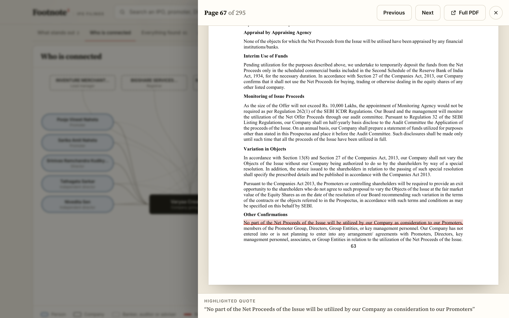<br><sub><b>The source</b>: page 67 of the real prospectus, the quoted sentence highlighted.</sub></td>
    <td width="50%" valign="top">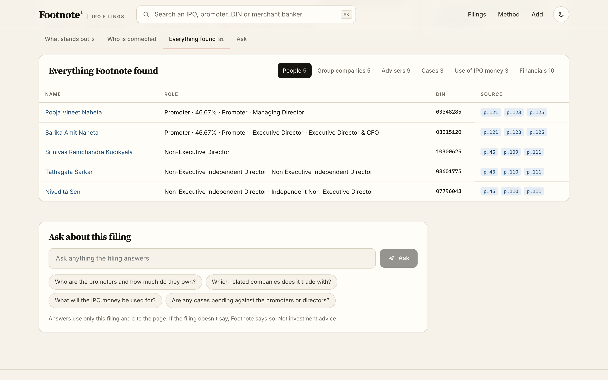<br><sub><b>Everything Footnote found</b>: people with DINs, group companies, advisers, cases, use of the money, financials.</sub></td>
  </tr>
  <tr>
    <td width="50%" valign="top">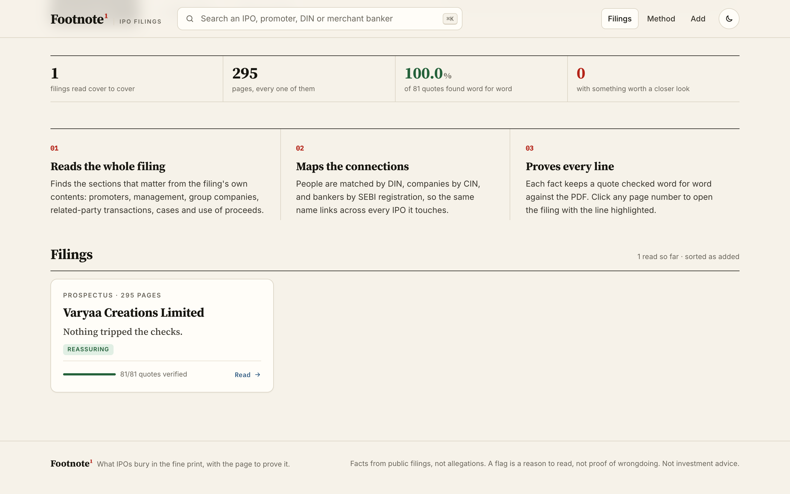<br><sub><b>How it checks</b>: read the whole filing, map the connections, prove every line.</sub></td>
    <td width="50%" valign="top">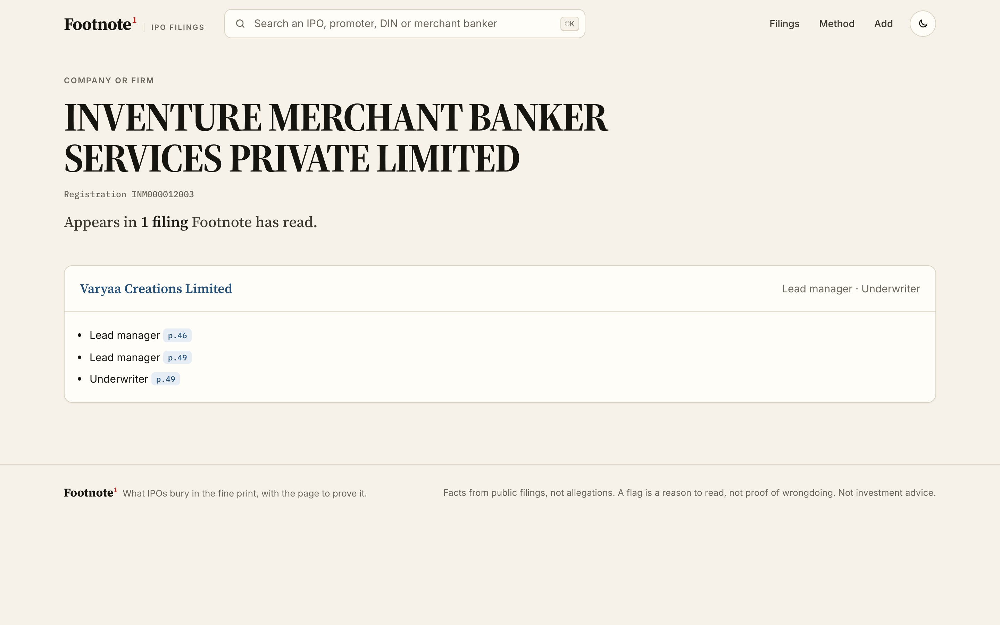<br><sub><b>A banker across filings</b>: matched by SEBI registration, with the role and page from each filing.</sub></td>
  </tr>
  <tr>
    <td width="50%" valign="top">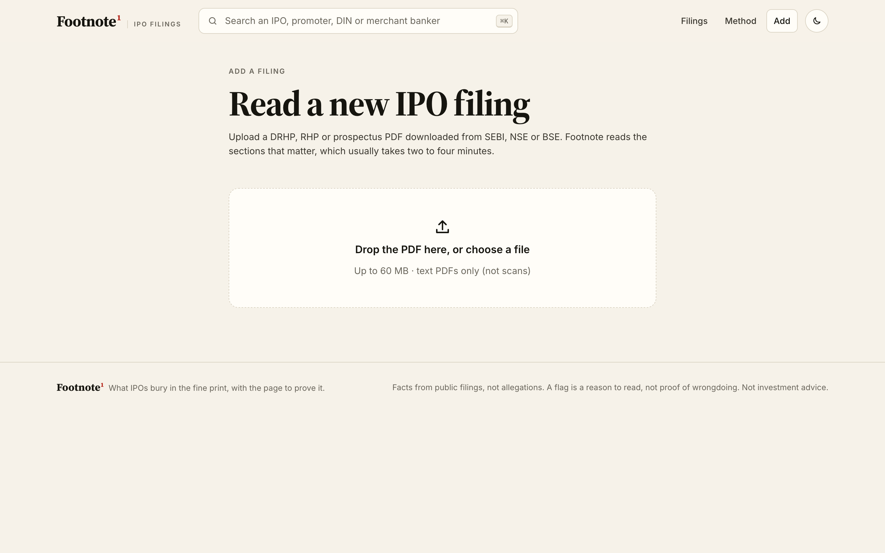<br><sub><b>Add a filing</b>: drag and drop, live steps, counters of what was found.</sub></td>
    <td width="50%" valign="top">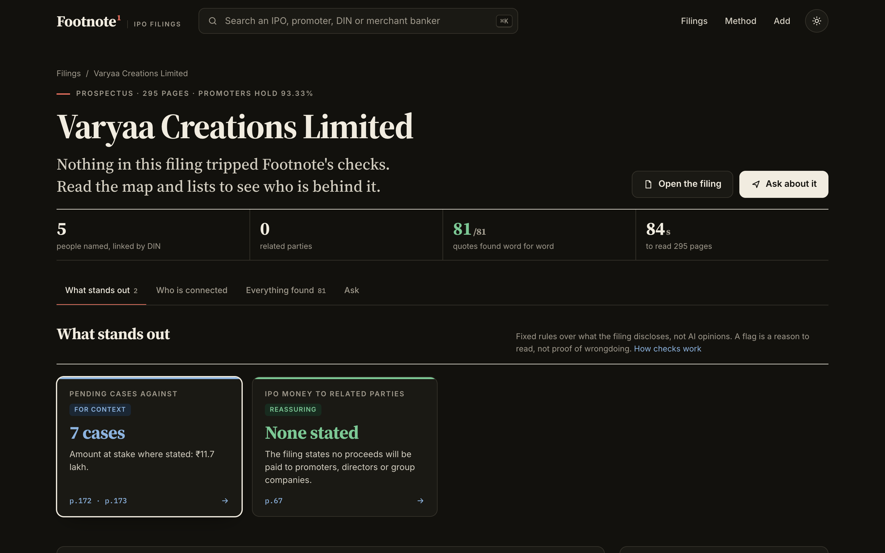<br><sub><b>Dark mode</b>: follows the system, or the header toggle.</sub></td>
  </tr>
</table>

<p align="center">
  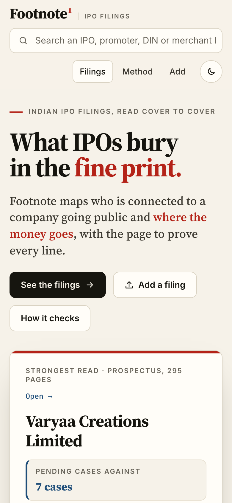
  &nbsp;&nbsp;&nbsp;
  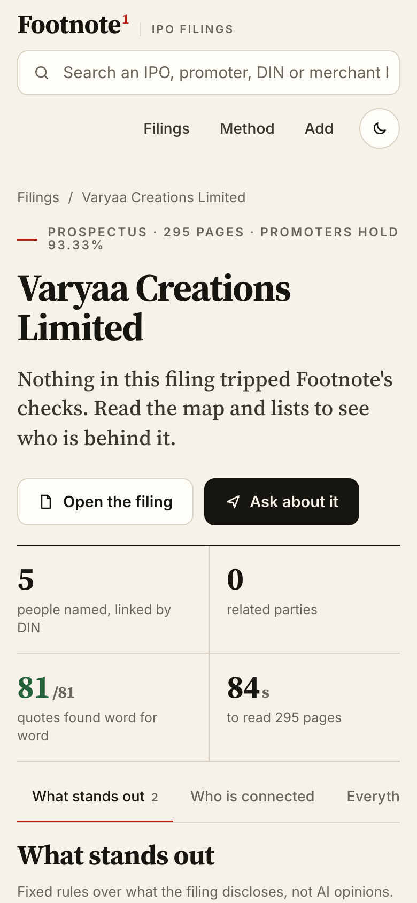
  <br>
  <sub><b>Phone</b>: the ledger folds to two columns and the section nav scrolls sideways.</sub>
</p>

## Results on real filings

### The SEBI test: an IPO SEBI later acted on

**Varyaa Creations Limited**, BSE SME, ₹20.10 Cr, 294-page prospectus. SEBI later issued an
interim order alleging that ₹14 Cr left the IPO account on listing day. That order was
revoked on 29 Dec 2025.

| | |
|---|---|
| Time | **84 s** |
| Facts extracted | **81**, all **81 quotes found word for word** |
| Flags | 7 pending tax cases (*for context*); no IPO money to related parties stated (*reassuring*) |

**Footnote found nothing alarming, and that was the right answer for the document.** The
money SEBI described went to entities the prospectus never names, after it was printed. What
the prospectus did contain was the yardstick: issue expenses of **₹60 lakh** (p.67), against
the ₹14 Cr SEBI says left as "IPO-related expenses". That figure is now the next field to
extract.

Full write-up: **[The SEBI test](https://footnote-story.vercel.app)** ·
run notes: [docs/sebi-test.md](docs/sebi-test.md)

### Accuracy on a mainboard RHP

The first real run: a **462-page** mainboard Red Herring Prospectus from SEBI's site, checked
against the pages by hand.

| | |
|---|---|
| Sections found from the filing's own table of contents | **9 of 9** |
| Model calls | **22** (about 40K input tokens) |
| Time | **2 min 22 s** |
| Facts extracted | **122**, of which **120 (98.4%)** found word for word |
| Connection map | **34 nodes, 55 edges** |
| Hand check | promoters and holding, all six director DINs, lead manager and registrar registrations, auditor change, group companies, related-party amounts to the decimal, and use of proceeds: all correct |

The seven bugs that run exposed, and their fixes, are in
[docs/real-filing-test.md](docs/real-filing-test.md).

## How it works

```
PDF ──► pypdf text + TOC ──► sections ──► LLM, fixed fields per section
                                              │
             SQLite ◄── verify every quote ◄──┘   (redact PAN / Aadhaar first)
               │
               ├──► link people by DIN, companies by CIN / SEBI registration
               ├──► fixed rules ──► flags + headline
               └──► graph, lists, TF-IDF index ──► FastAPI ──► React UI + pdf.js
```

| Layer | Choice | Why |
|---|---|---|
| PDF text and TOC | `pypdf` | Pure Python, no system libraries. Finds the printed-to-PDF page offset. |
| Extraction | Any OpenAI-compatible endpoint | Fixed-field prompts per section, ~9,000-character chunks, 4 in parallel, JSON repair, amounts in lakh / million / crore. |
| Verification | `ingest.Normaliser.verify()` | Every quote is re-found on its page; failures are labelled, not dropped. |
| Storage | SQLite | One file, no server. Filings, pages, entities, entity keys, facts and raw extractions. |
| Rules | `report.py` | Thresholds in `config.py`; a flag is a rule over cited facts, never a model opinion. |
| Retrieval | TF-IDF | No embedding API and no vector database to run or pay for. |
| API | FastAPI + uvicorn | Uploads run in a background thread with live progress. |
| UI | React 19 + Vite 7, no UI framework | A 28-line History router and design tokens in one CSS file. |
| PDF viewer | pdf.js 4.10, lazy-loaded | Main bundle **243 kB**; the viewer chunk (338 kB) loads only when a page is opened. |
| Redaction | `ingest.redact()` | PAN, Aadhaar and home addresses are scrubbed before anything is stored. |

More in [docs/architecture.md](docs/architecture.md), [docs/data-model.md](docs/data-model.md)
and [docs/red-flag-rules.md](docs/red-flag-rules.md).

## Quickstart

Needs **Python 3.10+** and **Node 20+**.

```bash
git clone https://github.com/prutxvi/footnote.git && cd footnote

# 1. Backend
cd backend
python -m venv .venv && source .venv/bin/activate
pip install -r requirements-dev.txt
cp .env.example .env                 # set LLM_API_KEY (any OpenAI-compatible endpoint)
uvicorn main:app --reload            # http://127.0.0.1:8000/docs

# 2. Frontend, second terminal
cd frontend
npm install
npm run dev                          # http://localhost:5173 (proxies /api to :8000)
```

Add filings from the **Add** page, or in bulk from the command line:

```bash
cd backend
python -m footnote.ingest ~/Downloads/filings/*.pdf       # read a folder
python -m footnote.ingest --relink <filing-id>            # re-run rules and matching, no model calls
```

Download filings by hand from SEBI, BSE SME or NSE Emerge. **NSE's terms prohibit automated
collection**, so Footnote never scrapes them.

### The lead-manager check

It reads `data/sebi_orders.json`, a hand-checked list. Copy `data/sebi_orders.example.json`,
add one entry per SEBI order with its URL, and the flag appears on every filing that banker
handled.

### Tests

```bash
cd backend && pytest
```

The suite builds offer documents as real PDFs and runs the whole pipeline on a `FakeLLM`, so
it needs no network and no key. It covers table-of-contents parsing and the page offset,
amount units, quote verification, PAN redaction, DIN-based matching, every flag rule,
cross-filing links, and the API. CI also runs the frontend lint and build, on Python 3.10 and
3.12.

## Project structure

```
footnote/
├── backend/
│   ├── main.py                   FastAPI app, API routes, SPA and PDF serving
│   ├── footnote/
│   │   ├── config.py             settings and flag thresholds from env
│   │   ├── llm.py                OpenAI-compatible client
│   │   ├── pdftext.py            page text, TOC parsing, page offset, sections
│   │   ├── extract.py            per-section prompt specs, chunk jobs, parallel run
│   │   ├── ingest.py             Ingestor, Normaliser, verify(), redact(), relink(), CLI
│   │   ├── store.py              SQLite schema and name normalisation
│   │   ├── report.py             flags, headline, graph, lists, entity_report()
│   │   ├── chat.py               per-filing indexes, numbered sources, citations
│   │   └── retrieve.py           small TF-IDF index
│   └── tests/                    16 tests on hand-built PDFs and a FakeLLM
├── frontend/src/
│   ├── App.jsx                   shell, search (⌘K), theme, lazy PDF viewer
│   ├── nav.js, router.jsx        28-line History router
│   ├── MapView.jsx               deterministic connection map
│   ├── PdfViewer.jsx             pdf.js plus quote highlighting
│   ├── pages/                    Home, Filing, Entity, Add, Method
│   └── styles.css                design tokens, light and dark
├── data/
│   └── sebi_orders.example.json  format for the hand-checked order list
├── docs/                         architecture, data model, rules, real-filing and SEBI tests
├── screenshots/                  the images above
├── .github/workflows/ci.yml      backend tests plus frontend lint and build
└── railway.json, nixpacks.toml   one-service deploy
```

## API

| Method | Path | What |
|---|---|---|
| GET | `/api/health` | version, whether an LLM is configured, whether uploads are allowed |
| GET | `/api/filings` | cards: company, headline, flag summary |
| GET | `/api/filings/{id}` | the full report: flags, graph, lists |
| GET | `/api/filings/{id}/status` | live ingest progress |
| GET | `/api/filings/{id}/pdf`, `/pages/{n}` | the PDF itself, and the text of one page |
| POST | `/api/filings` | upload; ingest runs in a background thread |
| POST | `/api/filings/{id}/chat` | a cited answer about that filing |
| GET | `/api/entities/{id}` | everywhere a person or company appears |
| GET | `/api/search?q=` | filings and entities by name, DIN, CIN or registration |

## Limits, and what this is not

- **A prospectus cannot show money that moves after it is printed.** Footnote reads what was
  disclosed; the SEBI test above is the clearest example.
- **Extraction can miss or misread items.** That is why every line links to its page and
  unverified quotes are labelled. Read the page before you believe the line.
- **A flag is a reason to read, not proof of wrongdoing.** Related-party transactions are
  legal and often ordinary.
- **Not investment advice.**
- Scanned (image-only) PDFs need OCR first.
- People without a DIN in the filing are **deliberately not linked** across filings, because
  names collide. Two rows that are probably the same person stay apart rather than risk a
  wrong merge.

## Privacy

Filing PDFs are public documents, but they print PAN, Aadhaar and home addresses. Footnote
scrubs those before anything is stored. Uploads are off by default on a public deployment
(`ALLOW_UPLOADS=0`), which serves only filings already read.

## Deploy

One service: the frontend build is copied into `backend/static` and FastAPI serves both.
`railway.json` and `nixpacks.toml` (Node 20 + Python 3.12) do this for you.

```bash
cd frontend && npm run build && rm -rf ../backend/static && cp -r dist ../backend/static
cd ../backend && uvicorn main:app     # serves API, UI and PDFs
```

Set `LLM_API_KEY` to allow uploads and questions, and `ALLOW_UPLOADS=0` to keep a public
site read-only.

## Roadmap

- [x] Publish as `prutxvi/footnote`
- [x] SEBI test 1 of 3: Varyaa Creations, with a [public write-up](https://footnote-story.vercel.app)
- [x] UI redesign: ledger, section nav, `⌘K` search
- [ ] SEBI tests 2 and 3: Synoptics Technologies and Nirman Agri Genetics
- [ ] Extract disclosed issue expenses as their own field
- [ ] A lead-manager page: every IPO a banker handled, with any SEBI orders
- [ ] Populate `data/sebi_orders.json` so the lead-manager check fires
- [ ] Deploy a read-only instance

## Contributing

See [CONTRIBUTING.md](CONTRIBUTING.md). Run `pytest` in `backend/` and `npm run lint` in
`frontend/` before opening a pull request.

## License

MIT © 2026 Toganti Pruthvi Raj. See [LICENSE](LICENSE). Third-party licences, including the
fonts and pdf.js, are in [THIRD-PARTY-NOTICES.md](THIRD-PARTY-NOTICES.md).

---

<div align="center">
<sub>Facts from public filings, not allegations. A flag is a reason to read, not proof of wrongdoing. Not investment advice.</sub>
</div>
